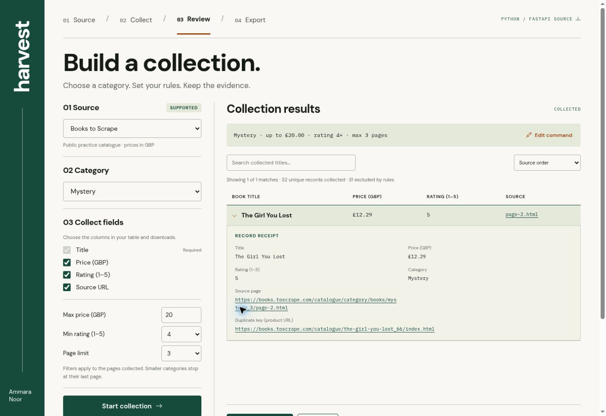
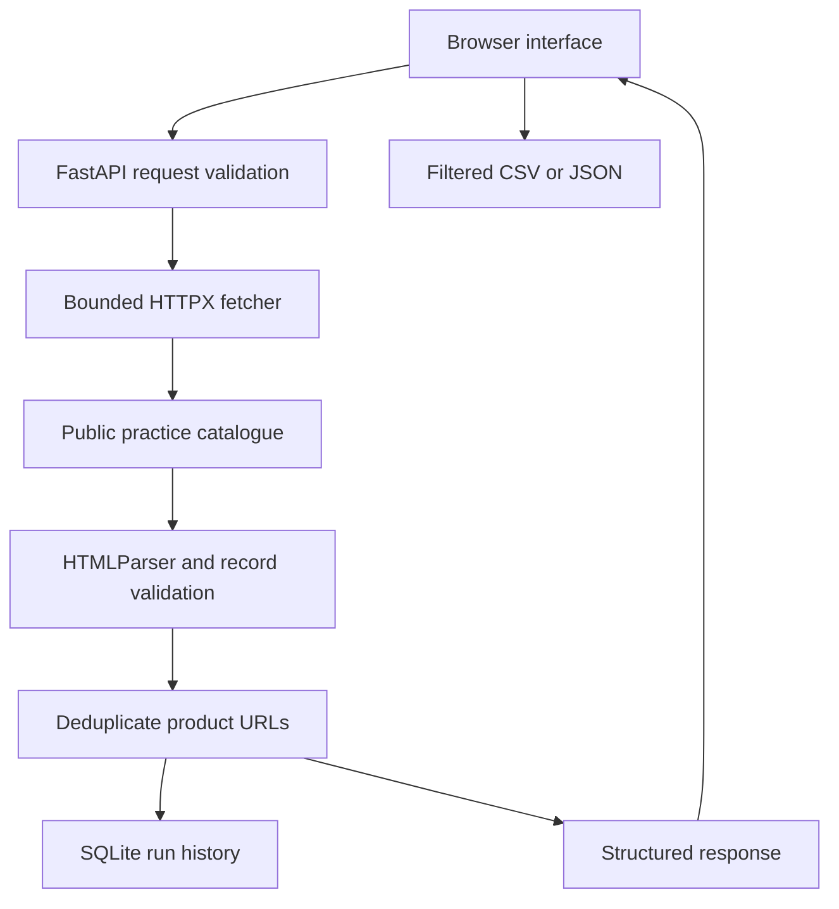

# Harvest

### Web scraping as a complete backend workflow

A Python/FastAPI application that turns public catalogue pages into validated, deduplicated records—with source provenance, SQLite run history, and CSV/JSON exports.

**[Open the live demonstration](https://harvest-ammara-scraper.dazzlingadage1.chatgpt.site/) · [Review the verification evidence](docs/VERIFICATION.md) · [Follow the development workflow](docs/DEVELOPMENT.md)**

| Backend | Extraction | Persistence | Validation | Packaging |
|---|---|---|---|---|
| Python 3.11+, FastAPI | HTTPX, HTMLParser | SQLite | Pydantic, unittest | Docker, GitHub Actions workflow |



## Try it in a minute

1. Open the live demonstration. The initial run collects the Mystery category, up to three pages, with price ≤ £20 and rating ≥ 4.
2. Inspect **The Girl You Lost** and expand its record receipt to see its original page and product link.
3. Export the filtered result as CSV or JSON.
4. Choose **All categories**, clear the price limit, choose **Any** rating, and select five pages to collect up to 100 records.
5. Open **Inspect the API response** to inspect source URLs, timestamps, page outcomes and warnings.

**Runtime distinction:** the public demo runs a JavaScript Cloudflare Worker. This repository contains the independently runnable **Python/FastAPI** version and the same frontend. The live link demonstrates scraping and exports; Python endpoints and SQLite persistence can be inspected by running this project. The hosted demo is not a deployed FastAPI service.

## The problem

A scraper is useful to an application only when its output is predictable. A page can fail, a price can be malformed, the source template can change, or the same product can appear twice. Harvest makes these outcomes visible instead of silently treating every response as successful data.

The source is [Books to Scrape](https://books.toscrape.com), a public scraping practice catalogue. Its prices and ratings are illustrative. This project does not collect personal data or access authenticated pages.

## What is implemented

- **Bounded pagination:** collect up to 1–5 pages, sequentially; stop at the category’s final page.
- **Structured extraction:** title, numeric GBP price, rating, availability, product URL and source-page URL.
- **Record validation:** reject malformed records, unexpected product hosts and missing required fields.
- **Recovery behaviour:** one retry for selected transient failures, per-request timeouts, and a total run deadline.
- **Partial results:** preserve successful pages while explicitly reporting failed pages and warnings.
- **Deduplication:** retain one record per product URL.
- **Persistence:** save successful Python runs in SQLite; retain the latest 50 and list the most recent 10.
- **Category collections:** discover 50 source categories, apply inclusive price and minimum-rating rules, and record each page outcome.
- **Editable commands:** turn a supported instruction into a reviewable collection plan using a deterministic parser. Unsupported instructions return an error.
- **Usable outputs:** title search, price/title sorting, selectable columns, and filtered CSV/JSON exports. Changed collection rules disable downloads until a new run finishes.
- **Reproducible checks:** 26 automated tests using an HTML fixture and mocked network responses.

## Architecture



The hosted demonstration substitutes a JavaScript fetcher and HTMLRewriter for the Python service. It has a small, 60-second in-memory response cache, with no shared database. See [runtime differences and verification scope](docs/VERIFICATION.md).

## Run locally

Requires **Python 3.11 or newer**. No paid API, Gemini key, or AI subscription is required.

### Windows and VS Code

Extract or clone the repository and open its root folder in VS Code:

```powershell
py -3.11 -m venv .venv
.\.venv\Scripts\python.exe -m pip install -r requirements.txt
.\.venv\Scripts\python.exe -m uvicorn harvest.api:app --reload
```

If `py -3.11` is unavailable, use `python` for an installed version >=3.11. Calling the virtual environment's Python directly avoids needing to change PowerShell's activation policy.

### macOS or Linux

```bash
python3 -m venv .venv
.venv/bin/python -m pip install -r requirements.txt
.venv/bin/python -m uvicorn harvest.api:app --reload
```

- Application: http://127.0.0.1:8000
- Interactive API documentation: http://127.0.0.1:8000/docs
- Health endpoint: http://127.0.0.1:8000/api/health

## API contract

| Method | Endpoint | Behaviour |
|---|---|---|
| GET | `/api/health` | Report runtime, source, maximum pages and storage |
| GET | `/api/categories` | Discover the source category list |
| POST | `/api/plan` | Convert a supported command into an editable plan |
| POST | `/api/scrape` | Validate input, collect products, and persist a successful run |
| GET | `/api/runs` | Return the 10 most recent stored Python runs |

Example request:

```bash
curl -X POST http://127.0.0.1:8000/api/scrape \
  -H "Content-Type: application/json" \
  -d '{"pages":3,"category":"mystery_3","max_price":20,"min_rating":4}'
```

In PowerShell:

```powershell
Invoke-RestMethod -Method Post -Uri http://127.0.0.1:8000/api/scrape `
  -ContentType 'application/json' -Body '{"pages":2}'
```

A response includes:

| Field | Purpose |
|---|---|
| `items`, `count` | Valid, deduplicated records and their count |
| `source`, `scraped_at` | Source identity and collection timestamp |
| `pages_requested`, `pages_succeeded`, `failed_pages` | Explicit pagination outcomes |
| `duplicates_removed`, `warnings` | Data-quality and extraction information |
| `duration_ms`, `runtime`, `cache_hit` | Execution context |
| `run_id` | Python-only identifier for the persisted run |

Invalid request fields or a page count outside 1–5 return **422**. A fully unsuccessful extraction returns **502**. Partial runs return successful records and identify the failed pages. Consult `/docs` for the generated request schema.

## Engineering decisions

| Decision | Reason and trade-off |
|---|---|
| Fixed source host | Prevents arbitrary URL fetching; adding another site requires a deliberate adapter |
| Sequential requests with a 250 ms pause | Keeps the practice demo bounded; sacrifices throughput |
| 8-second request timeout; one retry | Avoids indefinite waits without unbounded retries |
| 35-second run deadline | Places a bound on extraction; slower sources may yield partial results |
| Python standard-library HTMLParser | Avoids browser automation for static HTML; depends on the source template |
| Deduplicate by product URL | Gives stable product identity for this source; not a universal entity-resolution method |
| Parameterised SQLite writes | Keeps the local project simple and persistent; not a distributed job store |
| Filter-aware exports | Downloads reflect the visible result set; CSV cells guard against formula interpretation |

## Tests and CI

```powershell
.\.venv\Scripts\python.exe -m unittest discover -s tests -v
```

```bash
.venv/bin/python -m unittest discover -s tests -v
```

The included GitHub Actions workflow is configured to run tests on Python 3.11 and 3.12, followed by a Docker build. An actual GitHub run must complete before claiming CI is passing. Unit tests use a recorded source fixture and mocked HTTP responses; they do not continuously scrape the live site.

See [VERIFICATION.md](docs/VERIFICATION.md) for the checks executed during development and their limits.

## Docker

```bash
docker build -t harvest-api .
docker run --rm -p 8000:8000 -v harvest-data:/app/data harvest-api
```

The default SQLite file is `data/harvest.db`. Set `HARVEST_DB` to override it. The named volume above preserves the default database between container runs.

## Repository map

| Path | Responsibility |
|---|---|
| `harvest/scraper.py` | HTML parsing, record validation, retries, pagination and deduplication |
| `harvest/commands.py` | Deterministic, validated command-to-plan parser |
| `harvest/api.py` | FastAPI input schema, endpoints and SQLite storage |
| `frontend/index.html` | Results UI, filters and CSV/JSON generation |
| `tests/test_scraper.py`, `tests/test_collection.py` | Parser, transport, commands, categories, API and persistence tests |
| `tests/fixtures/catalogue.html` | Captured real practice-site HTML for deterministic tests |
| `.github/workflows/tests.yml` | Test matrix and Docker-build workflow |
| `docs/` | Verification evidence and development workflow |

## Limits and next steps

This is a new portfolio prototype, not evidence of commercial deployment. It supports one static catalogue template, not arbitrary sites or JavaScript-rendered pages. The Python API has no authentication, per-user rate limiting or background task queue. `/api/runs` is intended for local demonstration. Before exposing it publicly, define access controls, traffic limits and storage retention appropriate to the use case.

The live source can change or become unavailable. No load, penetration or continuous uptime testing has been performed. Gemini integration is **not implemented** and is not required for the current extraction workflow.

Useful next steps: independent source adapters, content-change regression fixtures, a persisted job queue, deployment of the Python service, and broader command grammar with explicit validation.

## Development approach

Developed with AI assistance; implementation details, executed checks and remaining limitations are recorded here so the project can be inspected and reproduced. Review the code and run the tests when adapting it.

**Author:** Ammara Noor · [GitHub](https://github.com/ammaran620-de)

## Command examples

- `Collect mystery books under £20, rated 4+ stars, max 3 pages`
- `Find science fiction books below £30, 2 pages`
- `Collect all books max 5 pages`

Use **Edit command**, apply the plan, review the controls, then select **Start collection**. This parser accepts one source category, optional price/rating rules, and 1–5 pages. It does not execute arbitrary code, discover arbitrary websites, or claim to scrape everything. Filters apply within collected pages; they do not search the entire catalogue. Empty matches are a successful collection with zero matching records.
